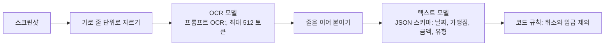
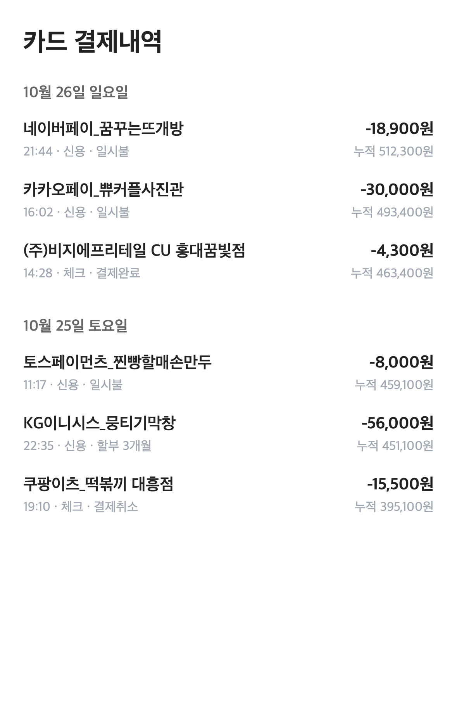
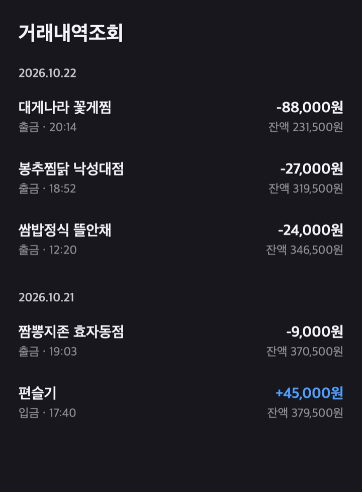

# 한국어 OCR 벤치마크

결제 내역 스크린샷에서 날짜, 가맹점, 금액을 뽑는 로컬 파이프라인을 고르기 위한 측정이다. OCR 모델과 정리용 텍스트 모델을 나눠서 비교했다.

| 항목 | 내용 |
| --- | --- |
| 측정일 | 2026-10-15 ~ 2026-10-30 (5회), 2026-11-04 (OCR 재측정) |
| 입력 | 합성 결제 화면 15장(가맹점 78건, 결제 67건), 선별 단계의 화면 5장(실제 캡처 3장, 합성 2장) |
| 정답 | 합성 화면은 생성 스크립트의 `truth.json`. 실제 캡처는 화면을 보고 작성한 기대값 |
| 환경 | M1 Max(Metal), 홈서버 Radeon 890M(Vulkan, 24스레드, RAM 30 GB) |
| 온도 | 0. 조합마다 1회 |

## 요약

- **OCR.** PaddleOCR-VL-1.6을 골랐다. 가맹점명 전체 일치가 83%(65/78)로 OvisOCR3 Q8_0의 60%(47/78)보다 높다. Ovis는 줄당 약 230 ms로 Paddle의 약 400 ms보다 빠르고 금액은 78/78을 맞췄다.
- **격차의 대부분은 화질이다.** 원본 해상도에서는 43/52와 38/52로 차이가 작다. 720px JPEG에서 22/26과 9/26으로 벌어졌다.
- **공개 벤치마크는 옮겨지지 않았다.** 모델 카드의 OmniDocBench 1.6은 Ovis 96.74, Paddle 96.34이고 OCRBench는 88.8, 55.9로 Ovis가 앞서지만 여기서는 순서가 뒤집혔다. 모델 카드에는 한국어 언급이 없다.
- **줄 단위로 잘라야 한다.** 화면 전체를 넣으면 Paddle이 열 단위로 읽어 왼쪽 가맹점과 오른쪽 금액의 짝이 깨졌다. 가로 줄로 잘라 넣자 짝이 모두 맞았다.
- **텍스트 모델.** Spark-X2.5-4B Q8_0을 유지했다. 합성 15장에서는 더 작은 IQ3_M이 절반 메모리로 15/15를 냈지만, 실제 캡처가 섞인 검증에서 완벽한 화면이 3/5에 그쳐 교체하지 않았다.

## 실행 이력

| 실행 | 날짜 | 질문 | 환경 | 입력 |
| --- | --- | --- | --- | --- |
| A | 2026-10-15 ~ 16 | 어떤 OCR 모델이 후보인가 | M1 Max, 홈서버, Ollama 0.35.1 | 화면 5장 |
| B | 2026-10-16 | 어떤 텍스트 모델이 후보인가 | M1 Max, Paddle 출력 고정 | 화면 5장 |
| C | 2026-10-28 | Paddle과 OvisOCR3 중 무엇이 나은가 | M1 Max, llama.cpp build 11669 (`620d2225c`), `-c 8192`, torch 2.14.1, transformers 5.13.1 | 합성 15장 |
| D | 2026-10-29 | Spark 변형 중 무엇이 나은가 | 홈서버, Ollama 0.35.1 (llama.cpp b11232) | 합성 15장 |
| E | 2026-10-30 | D의 IQ3_M으로 바꿔도 되는가 | 격리 서버, Ollama 0.40.6 | 화면 5장 |
| F | 2026-11-04 | C의 결과를 출력 원문과 함께 다시 얻을 수 있는가 | M1 Max, macOS 27.2, llama.cpp build 11669 (`620d2225c`), `-c 8192`, `--cache-ram 0` | 재생성한 합성 15장 |

## 파이프라인



## 데이터

| 세트 | 내용 | 화면 | 가맹점 행 | 결제 행 | 줄 |
| --- | --- | --- | --- | --- | --- |
| [`images/base`](images/base) | 흔한 가맹점과 희귀 음절 | 5 | 26 | 21 | 63~64 |
| [`images/real-names`](images/real-names) | 결제대행 표기와 실제로 쓰이는 형태의 상호 | 5 | 26 | 23 | 63~64 |
| [`images/degraded`](images/degraded) | `real-names`를 폭 720px, JPEG 품질 60으로 낮춤 | 5 | 26 | 23 | 63~64 |
| [`images/screening/bank-a.png`](images/screening/bank-a.png) | 선별 단계의 합성 화면 | 1 | 7 | | 13 |

가상의 이름과 금액으로 직접 작성한 HTML을 headless Chrome으로 렌더링했다(폭 393px, 배율 3, 1179px). 실제 앱 캡처가 아니다. `bank-a`의 제목 줄에 은행 이름이 들어 있지만 거래와 잔액은 모두 가공이다. 입력 난도를 높이려고 가맹점 이름에 빽, 쀼, 뷁, 똠 같은 음절과 `_`로 이어진 결제대행 표기를 넣었다.

| 합성 `real-names` | 합성 `degraded` |
| --- | --- |
|  |  |

여기 있는 이미지는 **재생성본이다.** 측정 당시 원본은 지워졌다. 같은 스크립트로 2026-11-04에 Chrome 157.0.8103.39로 다시 렌더링했으므로 내용은 같지만 픽셀까지 같다고 보장하지 않는다. 재생성본의 측정 결과는 [실행 F](#실행-f-재측정과-출력-공개)에 있다. 각 세트의 `strips/`는 OCR에 실제로 넣은 줄 이미지 190장이다.

공개하지 않은 입력은 실제 결제 캡처 3장과 `bank-b`다. `bank-b`는 합성이지만 실제 카드 내역의 가맹점명이 한 건 섞여 있다.

## 지표

채점 코드는 [`scripts/bench.py`](scripts/bench.py)와 [`scripts/score_text.py`](scripts/score_text.py)에 있다.

| 지표 | 정의 |
| --- | --- |
| 가맹점, 금액, 유형, 잔액 일치 | 공백과 가운데점을 정규화한 OCR 출력에 정답 문자열이 그대로 들어 있으면 일치 |
| CER | 화면별 편집 거리 / 정답 글자 수의 평균 |
| 완벽한 화면 | 결제 행 수가 맞고, 모든 금액이 찾아지고, 모든 날짜가 맞은 화면 |
| 모델 가맹점 오류 | OCR이 맞게 읽었는데 텍스트 모델이 바꾼 건. OCR 자체의 오독은 뺀다 |

가맹점 일치는 한 글자만 틀려도 실패다. 사용자가 틀린 이름을 고쳐야 하는지가 기준이기 때문이다.

## 실행 C: OCR 비교

Wilson 95% 구간이다. 화면 단위 쌍 자료가 남아 있지 않아 대응 검정 없이 각 모델의 구간만 계산했다. 같은 입력을 쓴 비교이므로 구간 겹침만으로 결론을 내리면 안 된다.

| 지표 | PaddleOCR-VL-1.6 F16 | OvisOCR3 Q8_0 |
| --- | --- | --- |
| 가맹점 `base` | 22/26 | 21/26 |
| 가맹점 `real-names` | 21/26 | 17/26 |
| 가맹점 `degraded` | 22/26 | 9/26 |
| **가맹점 전체** | **65/78 = 83%** [74, 90] | 47/78 = 60% [49, 70] |
| 원본 화질 두 세트 | 43/52 = 83% [70, 91] | 38/52 = 73% [60, 83] |
| 금액 | 76/78 (2건은 끝의 `원`만 누락) | **78/78** |
| 날짜, 유형, 잔액 | 모두 일치 | 유형 1건 오류 |
| 평균 CER | **0.69%** | 1.48% |
| 줄당 시간 | 약 400 ms | **약 230 ms** |
| 화면당 시간 (약 13줄) | 약 5.2 s | **약 3.0 s** |
| 디스크 | 1.82 GB | **1.02 GB** |
| 로드 후 메모리 | 2.2 GB | **1.8 GB** |
| 190줄 처리 후 메모리 (기본 캐시) | **2.6 GB** | 9.0 GB, 계속 증가 |

Ovis의 메모리 증가는 `--cache-ram 0`으로 해결된다(1.8 GB 유지).

**오류 유형이 다르다.** 이 차이가 숫자보다 중요하다.

| 모델 | 경향 | 예 |
| --- | --- | --- |
| Paddle | 모양이 비슷한 글자로 바꾼다 | 찜→점, 땡→맹 |
| Ovis | 흔한 낱말 쪽으로 바꾼다 | 쿠팡→쿠광, 카카오T 택시→카카오텍시, 꽃게찜→쫓게집, 뜨개방→소개방 |
| 공통 | | 빽→백, 쀼→뿌 |

**Ovis 변환본 비교.** Ovis GGUF는 `michalland/OvisOCR3-GGUF`의 비공식 변환본이다. F16 GGUF도 47/78로 같아 양자화 탓은 아니다. transformers BF16은 61/78로 올라가지만 줄당 약 900 ms다. 격차의 원인은 llama.cpp 전처리로 보이나(추정) 확인하지 않았다.

**시험을 끝내지 못한 후보.** OXR-1.0은 모델 카드 수치가 높았으나(OmniDocBench 97.18 대 Paddle 96.34, DocParsingBench 87.76 대 85.17) GGUF가 없고 vLLM과 VRAM 24 GB 이상을 요구하며 라이선스가 별도여서 다운로드 크기 문제로 측정을 중단했다. 로컬 CPU/MPS 시험에서는 영문 조각이 섞이고 HTML 태그가 새어 나왔다.

## 실행 F: 재측정과 출력 공개

실행 C의 출력 원문은 측정 당일 작업 폴더와 함께 지웠다. 출력을 공개하려고 재생성한 이미지로 Paddle과 Ovis Q8_0을 다시 돌렸다. 결과는 [`outputs/2026-11-04`](outputs/2026-11-04)에 줄별 글, 화면별 점수, 시간과 함께 있다.

| 지표 | Paddle C | Paddle F | Ovis C | Ovis F |
| --- | --- | --- | --- | --- |
| 가맹점 `base` | 22/26 | 22/26 | 21/26 | 21/26 |
| 가맹점 `real-names` | 21/26 | 21/26 | 17/26 | 18/26 |
| 가맹점 `degraded` | 22/26 | 23/26 | 9/26 | 9/26 |
| **가맹점 전체** | 65/78 | **66/78 = 85%** [75, 91] | 47/78 | **48/78 = 62%** [50, 72] |
| 금액 | 76/78 | 75/78 | 78/78 | 78/78 |
| 평균 CER | 0.69% | 0.70% | 1.48% | 1.44% |
| 줄당 시간 | 약 400 ms | 399 ms | 약 230 ms | 215 ms |

- **결론은 그대로다.** 가맹점 78건 중 Paddle만 맞힌 것이 22건, Ovis만 맞힌 것이 4건이다(부호 검정 p = 0.0005). 같은 화면의 행을 독립으로 본 근사다.
- **금액 3건.** 모두 저화질 세트의 Paddle 출력이다. 2건은 끝의 `원`이 빠졌고(`-4,400`, `-17,000`) 1건은 쉼표가 빠졌다(`-1800원`). 숫자 값은 모두 맞다. 10월의 2건은 끝의 `원` 누락으로만 기록되어 있다.
- **차이의 원인.** 같은 서버 설정으로 3회 돌린 190줄의 글이 두 모델 모두 완전히 같았다. 따라서 C와 F의 차이는 실행 간 무작위성이 아니라 재생성 이미지 때문으로 보인다(추정). 10월 이미지가 없어 확인하지 못했다.
- **`base`는 10월 기록과 같다.** 남아 있는 10월 로그와 비교하면 두 모델의 가맹점 오답 목록과 화면별 평균 CER(0.76%, 1.08%)이 일치한다.
- **다시 돌리지 않은 것.** Ovis F16과 BF16, 선별 단계(실행 A), 텍스트 모델(실행 B, D, E)은 출력이 남아 있지 않다. 실제 캡처가 들어간 실행의 출력은 재측정해도 공개하지 않는다.

모델 파일은 저장소 리비전과 SHA-256을 [`scripts/rerun.sh`](scripts/rerun.sh)에 고정했다. 10월에 받은 파일의 해시는 기록이 없어 같은 파일임을 보장하지 못한다.

## 실행 D: 텍스트 모델 비교

합성 15장, 결제 67건, 같은 Paddle 출력을 입력으로 썼다. OCR 시간은 화면당 평균 8.5초(최대 10.8초)이며 아래 시간에 포함되지 않는다. 원본은 [`data/spark_variants.csv`](data/spark_variants.csv)에 있다.

| 모델 | 디스크 GB | 메모리 MiB | 첫 응답 s | 화면 평균/최대 s | 생성 tok/s | 완벽한 화면 | 찾은 결제 | 모델 가맹점 오류 | 추가 행 |
| --- | --- | --- | --- | --- | --- | --- | --- | --- | --- |
| Spark-X2.5-4B Q8_0 | 4.38 | 4,488 | 6.1 | 19.9 / 25.3 | 20.3 | 14/15 | 67/67 | **0** | 1 (중복) |
| Spark-X2.6-4B Q8_0 | 4.38 | 4,488 | 5.0 | 22.2 / 37.7 | 20.3 | 15/15 | 67/67 | 2 | 0 |
| abenzerps X2.6-4B IQ4_XS | 2.59 | 2,790 | 2.9 | 12.2 / 16.2 | 31.8 | 15/15 | 67/67 | 8 | 0 |
| abenzerps X2.6-4B IQ3_M | 2.28 | 2,489 | 4.5 | 12.8 / 16.1 | 34.2 | 15/15 | 67/67 | 1 | 0 |
| cinnybun02 X2.6-4B Sharp Q5_K_M | 2.98 | 3,155 | 5.0 | 14.2 / 18.1 | 28.4 | 15/15 | 67/67 | 2 | 0 |
| Spark-X2.6-1.7B Q8_0 | 1.82 | 1,914 | 3.5 | 10.5 / 13.8 | 44.5 | 7/15 | 65/67 | 3 | 23 |

OCR 오독 17건은 모든 텍스트 모델에 똑같이 전달됐다(맹겨요, 뿌커플, 숙불닭갈비 등). 텍스트 모델이 고치지 못하므로 이름 정확도의 상한은 OCR이 정한다.

## 실행 E: IQ3_M 검증

실행 A와 같은 5장에 IQ3_M을 돌렸다. 합성 15장에서 깨끗했던 모델이 실제 캡처에서 오류를 냈다.

| 지표 | 값 |
| --- | --- |
| 찾은 결제 | 27/27, 누락과 추가 없음 |
| 날짜 | 26/27 |
| 가맹점 | 26/27 |
| 완벽한 화면 | 3/5 |
| 화면 평균/최대 | 12.4 s / 16.4 s |
| 메모리 (`/api/ps`) | IQ3_M 2,519 MiB, Paddle 986 MiB |

같은 오류가 온도 0의 두 번째 실행에서도 재현됐다. 합성 화면만으로 텍스트 모델을 고르면 안 된다는 근거다. 이 표본 크기로 Q8_0과의 차이를 확정할 수는 없어, 교체하지 않는 쪽으로 판단했다.

## 실행 A: OCR 선별

| 모델 | 결과 | 판단 |
| --- | --- | --- |
| PaddleOCR-VL-1.6 F16 (공식 GGUF) | 5장에서 글자 오류 없음, 줄 단위로 짝 정상, Mac 4~13 s, 홈서버 4.4~14.6 s | 채택 |
| PaddleOCR-VL-1.6 Q8_0 (SanjeevSOLANKI) | F16과 출력 동일 | 동등 |
| LightOnOCR-3 0.8B Q8 (Prathat) | 빠르지만 합성 화면에서 오타 4건 | 탈락 |
| LightOnOCR-3 1B | 오타 있음 | 탈락 |
| LightOnOCR-3 4B Q8 | 정확하지만 Mac에서 19~36 s | 탈락 |
| GLM-OCR Q8 (ggml-org) | 한글 오류 다수, 14~18 s | 탈락 |
| Trida2.0-4B | 1행에서 출력 중단 | 탈락 |
| MiniCPM-V-4.7-1B | Ollama 0.35.1에서 `unknown projector type: minicpmv4_7` | 시험 불가 |
| GravityOCR-KO | GGUF 없음 | 시험 불가 |

Paddle의 thinking 모드는 100~190초가 걸렸고 온도 0에서 6144 토큰까지 반복에 빠져 쓸 수 없었다.

이 단계의 "글자 오류 없음"은 쉬운 5장의 결과다. 어려운 세트를 넣은 실행 C에서는 83%로 내려갔다.

## 실행 B: 텍스트 모델 선별

Paddle 출력을 고정하고 M1 Max에서 5장, 27건으로 비교했다.

| 모델 | 정확한 화면 | 비고 |
| --- | --- | --- |
| Spark-X2.5-4B Q8_0 (공식) | 5/5 | 화면당 24~39 s. 채택 |
| Spark uncensored Q8_0 | 5/5 | 공식과 토큰까지 동일 |
| Spark uncensored Q4_K_M | 4/5 | thinking 반복으로 92 s |
| Spark Sharp Q4_K_XL | 3/5 | 날짜 오류, 3072 토큰까지 반복해 98 s. 약 48 tok/s (Q8은 약 20) |
| MiniCPM5-2B abliterated Q8_0 | 1/5 | 9~17 s로 빠르지만 이름 잘림, 날짜 오류, 0행 응답, 금액 오류 |

서비스 환경에서 잰 전체 처리 시간은 첫 모델 로드 포함 29.8 s, 이후 25.6 s와 31.9 s였고 두 모델의 GPU 메모리는 약 5.7 GB였다.

## 한계

- 합성 화면이 주 평가 입력이다. 실행 E가 보여 주듯 실제 캡처와 결과가 다를 수 있다.
- 실제 캡처 표본은 3장이고 공개할 수 없어 외부 검증이 안 된다.
- 조합마다 1회만 돌렸다. 온도 0이어도 시간 값에는 변동이 있다.
- Paddle과 Ovis의 가맹점 비교는 78건이다. 쌍 자료가 남아 있지 않아 대응 검정을 하지 못했다.
- Ovis GGUF의 Ollama 동작과 iGPU 절대 속도는 확인하지 않았다.
- 실행 C의 시간은 M1 Max, 실행 D의 시간은 Radeon 890M 값이다. 서로 비교할 수 없다.

## 기록 상의 불일치

- 운영 Ollama 버전이 10-28 기록은 0.40.6(nix 설정에서 읽음), 10-29 기록은 실제 실행 중인 0.35.1, 10-30 기록은 0.40.6이다. 언제 올렸는지는 확인하지 못했다.
- 실행 B의 로그는 28건이라 적었지만 화면별 합은 27건이다. 이 보고서는 27건을 쓴다.
- 계획에는 JPEG 품질 70으로 적었고 실제 명령은 60이다. 이 보고서는 명령을 따른다.

## 재현

```bash
# 이미지와 정답 파일을 다시 만든다 (macOS, Chrome, sips 필요)
scripts/render.sh

# 가맹점 구간과 결제 행 수를 계산한다
python3 scripts/summarize.py .
```

OCR 측정은 `scripts/bench.py`를 OpenAI 호환 `llama-server`에 연결해 돌린다. 공개한 줄 이미지로 실행 F를 다시 돌리려면 아래 `rerun.sh`를 쓴다. 모델 약 2.8 GB를 받고, M1 Max에서 측정은 약 2분 걸린다. 줄 자르기 코드는 비공개 서비스 코드의 일부라 공개하지 않았다. 새 이미지를 넣으려면 직접 구현해야 한다. 텍스트 모델 실행 코드도 같은 이유로 빠져 있고, `scripts/score_text.py`는 채점 정의를 보여 주는 용도다.

```bash
# llama-server build 11669에서 측정했다. <출력 폴더>/<세트>/out/ 에 결과가 생긴다
scripts/rerun.sh <모델 폴더> <출력 폴더>
```
